<p align="center">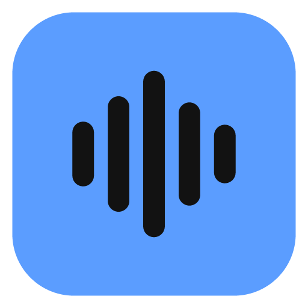</p>

<h1 align="center">Tonalo</h1>

<p align="center">A Navidrome client for LG TVs and the iPhone. Play your own music library from the couch with nothing but the remote, or take it with you.</p>

<p align="center">
  
  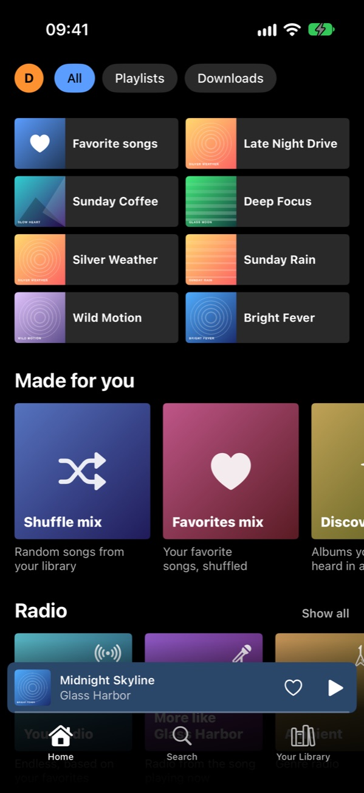
</p>

Tonalo talks to any server that speaks the Subsonic API. It was built and tested against Navidrome; other Subsonic servers should work but haven't been tried.

There are two apps in this repository. They share the name, the icon and the idea, but no code, because each one is written for its platform:

| | TV app | iPhone app |
|---|---|---|
| Runs on | LG TVs with webOS 5 or newer | iPhone with iOS 17 or newer, plus Apple Watch |
| Code | [`tv/`](tv) – plain HTML, CSS and JavaScript | [`ios/`](ios) – Swift and SwiftUI |
| Install | `.ipk` from the [releases](../../releases/latest) | Public beta on [TestFlight](https://testflight.apple.com/join/vKkNhNZJ), or build it with Xcode |

## TV app

Navidrome's web UI technically works in the TV browser, but it's made for a mouse and gets fiddly fast. The TV app is a native webOS app built around the remote: arrow keys and OK to get around, Back to go back, and the play/pause and skip buttons do what you'd expect.

### What it does

- Home screen with recently played, recently added, most played and a shuffle mix
- Albums, artists, playlists, genres, favorites and search
- Full-screen player with synced lyrics (if your server has them)
- Queue that survives restarts, plus "play next" and adding to playlists (with a warning for duplicates). Songs in the queue can be moved with ▲▼
- **Endless radio** from a song, an artist, a genre or your favorites – it tops itself up and learns from skips and hearts. Autoplay keeps going with similar songs when an album or playlist ends
- **Radio stations** set up on your server (Navidrome: Radio) play live
- Rename and delete your playlists and remove songs from them; a sleep timer, crossfade (3–12 seconds) and volume leveling with ReplayGain
- **Continue on another device**: the queue is kept on your server, so the TV offers to pick up where the iPhone left off (and the other way round)
- Several people on one TV: everyone signs in once, then picks their profile on start. Queues and settings stay separate.
- Transcoding options for weaker Wi-Fi, scrobbling, and a moving screensaver so the OLED doesn't burn in
- English, German, Spanish, French, Italian, Portuguese, Dutch, Polish and Turkish – it follows the TV's language

| | |
|---|---|
| 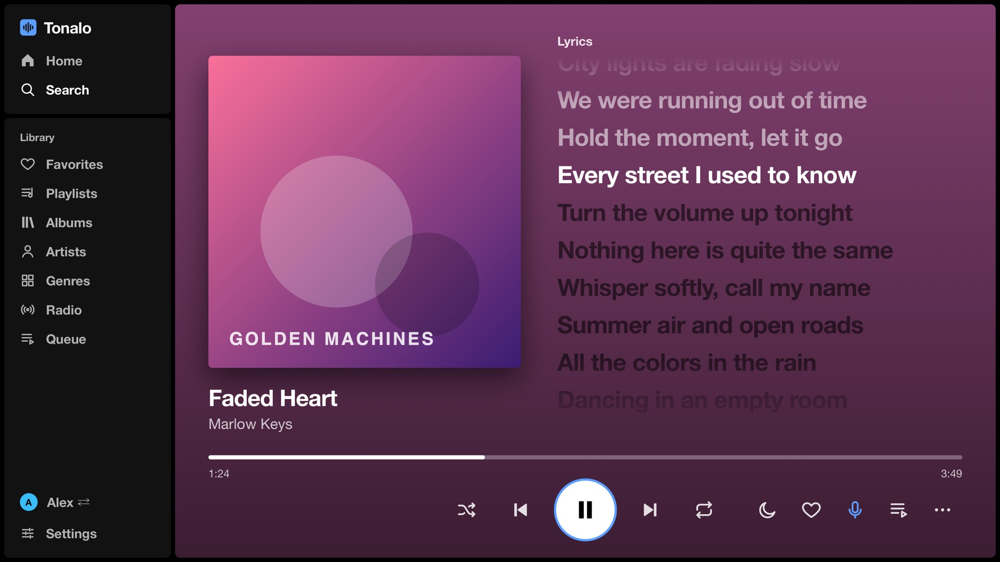 |  |
| 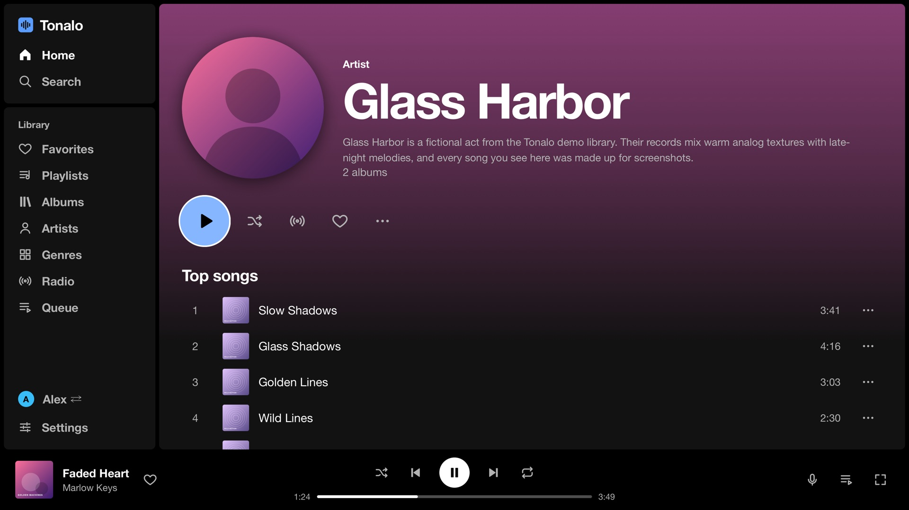 |  |
| 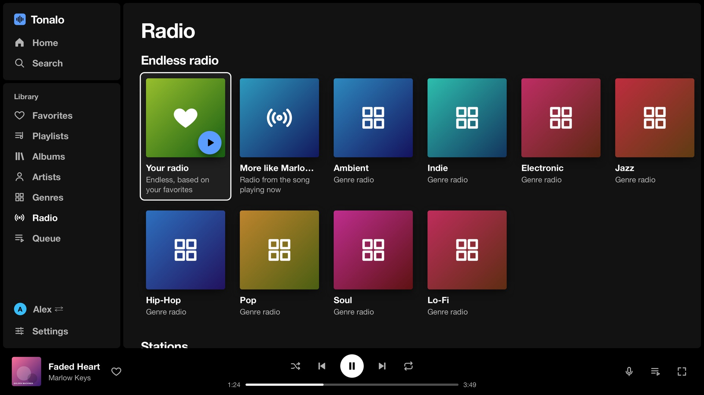 | 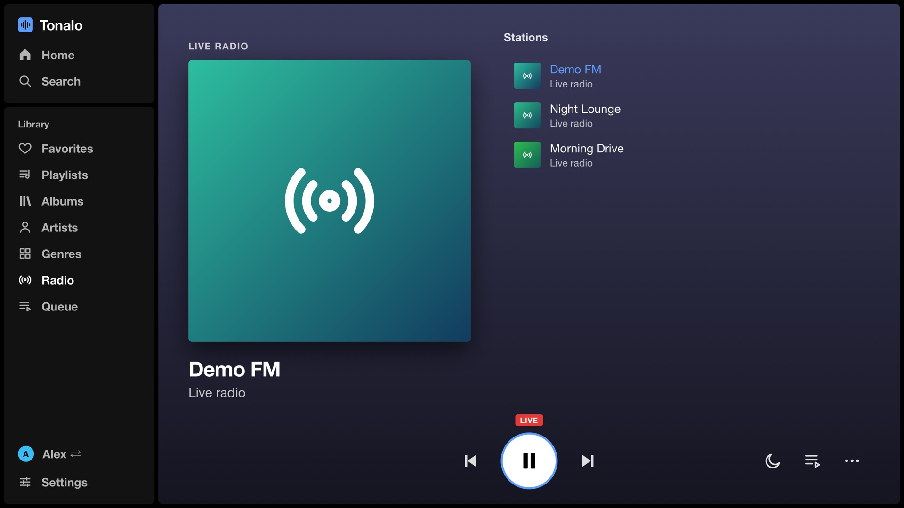 |

<p align="center">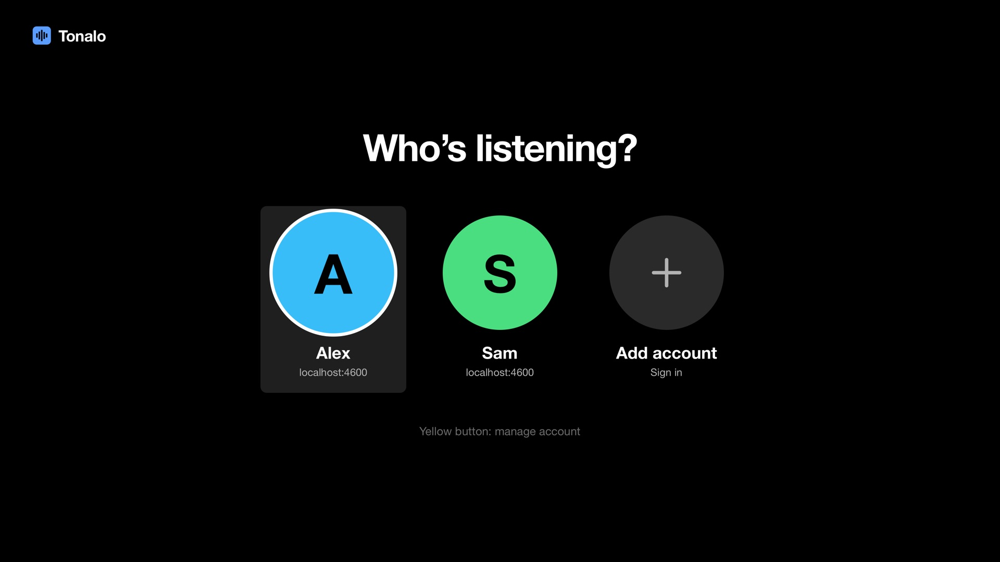</p>

### Installing

**Rooted TV with the Homebrew Channel (easiest)** – add Tonalo's repository once, then install and update it like any other Homebrew app. In the Homebrew Channel open *Settings*, choose *Add repository* and enter:

```
https://raw.githubusercontent.com/Wzkiie/tonalo/repo/apps.json
```

Tonalo then shows up in the app list. New versions appear there as soon as they're released.

The other ways need the `.ipk` from the [latest release](../../releases/latest).

**Rooted TV, by hand** – the deploy script, which uploads the package over the root telnet shell, installs it and starts the app:

```bash
python3 tv/tools/deploy.py 192.168.x.x    # your TV's IP
```

With SSH enabled you can also do it by hand:

```bash
scp tonalo_*.ipk root@<tv-ip>:/tmp/tonalo.ipk
ssh root@<tv-ip> "luna-send-pub -i 'luna://com.webos.appInstallService/dev/install' '{\"id\":\"tonalo\",\"ipkUrl\":\"/tmp/tonalo.ipk\",\"subscribe\":true}'"
```

**TV in Developer Mode** – install the package with [webOS Dev Manager](https://github.com/webosbrew/dev-manager-desktop) or `ares-install`. Keep in mind that Developer Mode expires unless you extend the session, and the TV removes the app when it does.

On first start, enter your server address (for example `http://192.168.1.10:4533`), user name and password. The password itself isn't stored, only the salted token the Subsonic API uses.

Tested on an LG OLED65CX with webOS 5.6. Anything from webOS 5 up should be fine; older versions are untested.

### Remote

| Button | Action |
|---|---|
| Arrows / OK | Move around / select |
| Back | Go back; at the top level it takes you to the sidebar, then asks to quit |
| ▶ ❚❚ ■ | Play, pause, stop |
| ⏪ ⏩ | Skip 10 seconds, hold to change songs |
| CH + / – | Scroll a page at a time |
| Red / Green / Yellow / Blue | Now playing / Search / Options / Play-pause |

The Magic Remote pointer works too.

## iPhone app

A native SwiftUI app that feels like the big streaming apps rather than a classic Subsonic client.

<p align="center">
  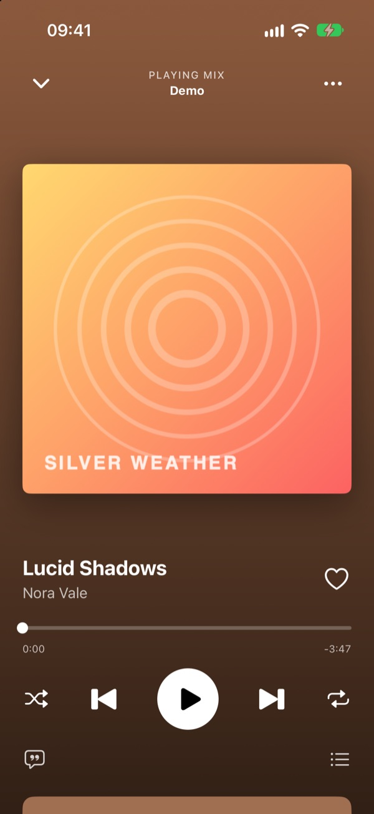
  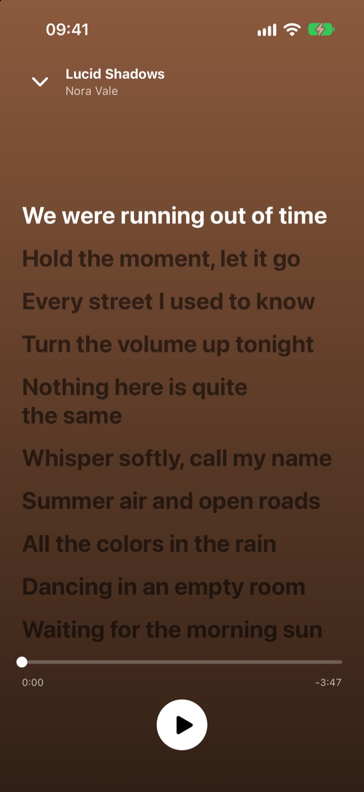
  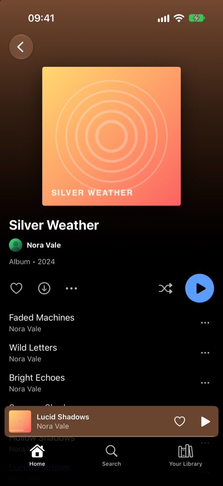
</p>
<p align="center">
  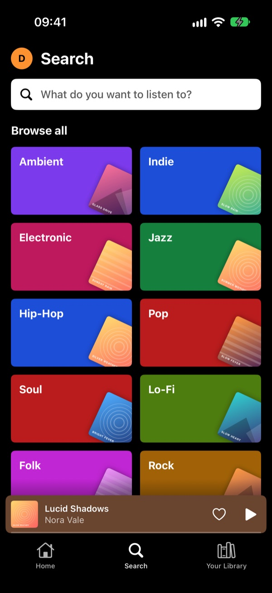
  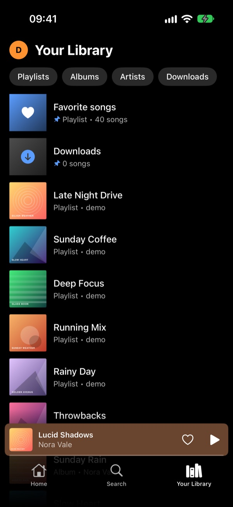
  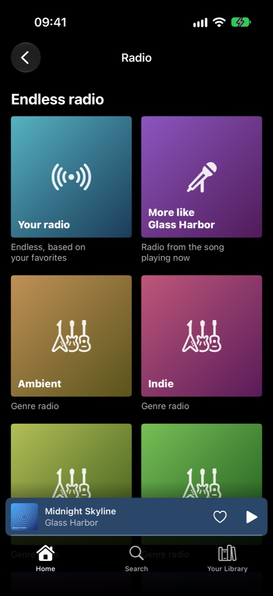
</p>
<p align="center">
  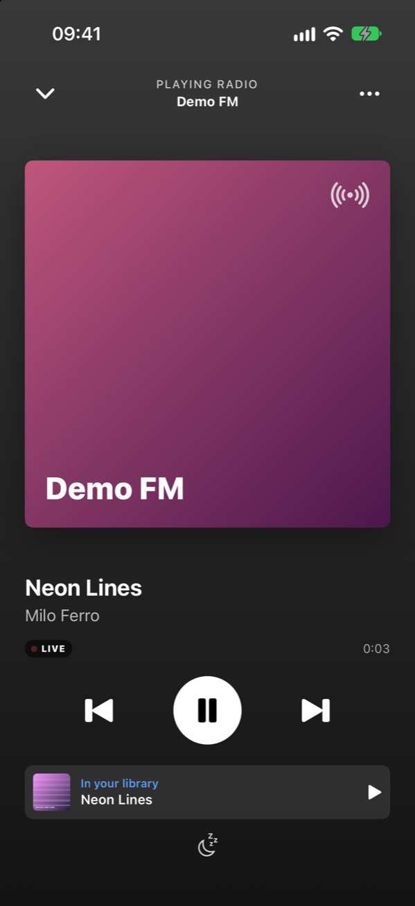
</p>

### What it does

- Home, search with genre tiles, and a library with playlists, albums, artists and downloads – sortable, searchable, with pinning (long press) and as a list or grid
- Player with synced lyrics, a queue you can reorder by dragging, swipe gestures, colors taken from the cover and a sleep timer
- **Endless radio**: from a song, an artist, a genre or your favorites. It tops itself up, plays more like what you hear to the end or give a heart, and less of what you skip. Without Last.fm it stays in the genre. When an album or playlist ends, Autoplay keeps going with similar songs (can be turned off)
- **Radio stations**: the stations set up on your server (Navidrome: Radio) play live, with the song on air when the station sends it. If that song is in your library, one tap plays it from there
- **Artist pages** with popular songs, the discography, "Fans also like" and a biography. Without Last.fm on the server, the artist's songs you played most stand in for the popular ones – see [Server tips](#server-tips)
- **Continue on another device**: started on the TV, finished on the iPhone – the app offers to pick up the queue another device left on your server
- **Play on the TV**: pair the iPhone with your TV once with a code. While the TV plays, the phone shows it live, and music you pick on the phone plays on the TV. "Play on iPhone" takes it back at the same second
- **Jukebox**: friends nearby join with a code, add songs to what's playing and skip. The TV hosts it at home, an iPhone in the car – the phones connect directly, without Wi-Fi. Guests need an account on the same server
- **Playlists**: create, rename and delete them, add songs from any menu (with a warning for duplicates), remove and reorder songs
- **Crossfade** between songs, adjustable from 1 to 12 seconds
- **Audio quality** set separately for Wi-Fi, cellular and downloads: the original files (lossless, FLAC stays FLAC) or converted by your server to AAC, Opus or MP3, with the data an hour of music takes next to each level. Formats the iPhone can't play are converted automatically.
- **Offline downloads** of songs, albums and playlists, in the background, optionally only on Wi-Fi. A small counter above the player shows how far they are on every page, and a note says when they're done. Lyrics come along, and scrobbles made offline are sent later.
- **Library sync**: loads every album, artist and playlist onto the phone in one go, so the whole library opens instantly and offline. Repeat it whenever you like; the app reminds you after a month.
- **Loading ahead**: the next songs of the queue (1–5, adjustable) are loaded in the background, so a dead spot on the train doesn't stop the music
- **Address at home**: on Wi-Fi the app talks to your server directly in the home network when it answers, and switches back to the outside address when you leave – mid-song without a gap
- **Volume leveling** with the ReplayGain tags of your files, per song or per album
- **Favorites from the lock screen**: a heart button for Control Center and the lock screen (iOS 18+) and a Siri shortcut ("Add this song to my favorites in Tonalo")
- **Apple Watch app**: player with cover, favorites, shuffle and the iPhone's volume on the Digital Crown, plus your playlists and favorites to start music from the wrist. It remote-controls the iPhone.
- **CarPlay**: Home, Library and Downloads on the car screen, with shuffle, repeat and a heart in the player (no search – Apple doesn't allow a keyboard in CarPlay music apps)
- Several accounts, accent colors and alternative app icons
- **Custom HTTP headers per account**, sent with every request including the audio stream and cover art, so servers behind Cloudflare Access (service token), Authelia or a similar proxy work. There's a one-tap preset for the two Cloudflare Access headers, and all secrets live in the iOS Keychain.
- English and German

### Installing

**TestFlight (easiest):** join the public beta at [testflight.apple.com/join/vKkNhNZJ](https://testflight.apple.com/join/vKkNhNZJ). Install Apple's TestFlight app, open the link on your iPhone and tap *Install*. The Apple Watch app comes along if your iPhone is paired with a watch. Each beta build runs for 90 days; TestFlight offers the next one when it's out. An App Store version will follow.

Feedback is very welcome – as a [GitHub issue](../../issues/new/choose), or with a screenshot straight from TestFlight. Note that TestFlight itself passes crash reports and basic usage data to the developer; the app collects nothing (see the [privacy policy](PRIVACY.md)).

**Build it yourself:** to put your own build on your phone:

1. Open `ios/Tonalo.xcodeproj` in Xcode.
2. Create `ios/Local.xcconfig` with your team ID, `DEVELOPMENT_TEAM = ABCDE12345` (git ignores this file). Alternatively, pick your Apple ID as the team under *Signing & Capabilities* for the Tonalo, TonaloControls and TonaloWatch targets.
3. Connect your iPhone and run the *Tonalo* scheme. The watch app comes along automatically if your iPhone is paired with an Apple Watch.

With a free Apple ID the app has to be reinstalled every 7 days. CarPlay needs an entitlement Apple grants per developer account, so for your own build switch it off with `TONALO_APP_ENTITLEMENTS =` in `ios/Local.xcconfig` (details in [`docs/CARPLAY.md`](docs/CARPLAY.md)).

## Server tips

**Connect Last.fm to Navidrome.** Popular songs, similar artists ("Fans also like") and artist biographies come from your server, and Navidrome gets them from Last.fm. Without it, both apps still work, but artist pages stay rather empty (the iPhone app shows your own most played songs instead). Setting it up takes two minutes and is free:

1. Create an API account at [last.fm/api/account/create](https://www.last.fm/api/account/create) – only the application name is required. Note the *API key* and *Shared secret*.
2. Give them to Navidrome, for example in your Docker Compose file:

   ```yaml
   environment:
     ND_LASTFM_APIKEY: your-api-key
     ND_LASTFM_SECRET: your-shared-secret
   ```

   or as `LastFM.ApiKey` and `LastFM.Secret` in `navidrome.toml`.
3. Restart Navidrome. Artist info is fetched when an artist is opened, so the first visit can take a moment.

The same key also lets every user scrobble to Last.fm from Navidrome's web UI. Details are in Navidrome's [external integrations](https://www.navidrome.org/docs/usage/external-integrations/) docs.

**Lyrics** come from your server too: Navidrome shows lyrics that are embedded in the files or stored next to them as `.lrc`.

## Development

### TV app

There's no framework and no build step – plain HTML, CSS and JavaScript in `tv/app/`. The code sticks to what the Chromium 68 engine in webOS 5 understands, so no optional chaining, `??`, flexbox `gap` and so on.

```bash
node tv/tools/mock_server.js            # demo server + app on http://localhost:4599
python3 tv/tools/build_ipk.py           # builds tv/dist/*.ipk and the Homebrew Channel manifest
node tv/tools/i18n_check.js             # checks that every language has every string
swift tv/tools/screenshots.swift http://localhost:4599 shots   # renders the TV screenshots (macOS)
```

In a desktop browser the UI scales to the window, and arrow keys, Enter and Esc behave like the remote. Log in to the mock server with any user name and password.

**Translations:** German is the source language. The code uses `T('German text')` and each file in `tv/app/js/lang/` maps those strings to another language. To add a language, copy `en.js`, translate it, and register it in `index.html` and `tv/app/js/i18n.js`. Corrections from native speakers are very welcome.

**Releases:** bump the version in `tv/app/appinfo.json` and `tv/app/js/util.js`, commit, then push a tag (`git tag v1.5.1 && git push origin v1.5.1`). GitHub Actions builds the package and publishes the release.

### iPhone app

Swift 5 with SwiftUI and `@Observable`, no third-party dependencies. Texts live in String Catalogs (`Localizable.xcstrings`), with English as the source language.

The iPhone screenshots use the same demo server as the TV. It draws its covers as SVG, which iOS can't show, so render them to PNG first:

```bash
swift ios/tools/render_covers.swift http://localhost:4599 covers
MOCK_COVERS=covers node tv/tools/mock_server.js
```

Debug builds sign in to that server when launched with `-demoAccount -demoServer http://localhost:4599`, and `-demoQueue` fills the queue without starting playback. `-demoHome <url>` and `-demoHeader Name=value` set a home address and a custom header, to try both routes.

The demo server has a few switches for testing: `MOCK_SILENT=1` streams silence, `MOCK_LOG=1` prints every request with the address it came in on, and `MOCK_SLOW=1` makes downloads take about 20 seconds. Start a second one on another port (`node tv/tools/mock_server.js 4598`) to stand in for the home address.

The screenshots in this README use a made-up demo library (`tv/tools/mock_server.js`), not real artists.

## Security

- Your password is never stored. Like every Subsonic client, Tonalo keeps the salted token derived from it, and that token is sent with each request. Anyone who gets hold of it can use your server account (but not learn the password) – so use https for any server reachable from the internet.
- iPhone: the token and custom headers live in the Keychain, only on that device. Library info and covers are kept on the device so pages open at once and offline, but never the request addresses, which carry the token. Custom headers never follow a redirect to another host, and plain http is only tried automatically for home-network addresses.
- TV: webOS has no secure storage, so the token sits in the app's local storage. Without a scheme, addresses in the home network use http and all others https.

Found a security problem? Please report it privately – see [SECURITY.md](SECURITY.md). For bugs and ideas, use the [issue forms](../../issues/new/choose).

## Notes

Tonalo doesn't collect any data – see the [privacy policy](PRIVACY.md). It isn't affiliated with Navidrome, LG or Apple. A good part of the code was written together with an AI coding assistant; everything was tested on a real TV and iPhone.

## License

[MIT](LICENSE)
