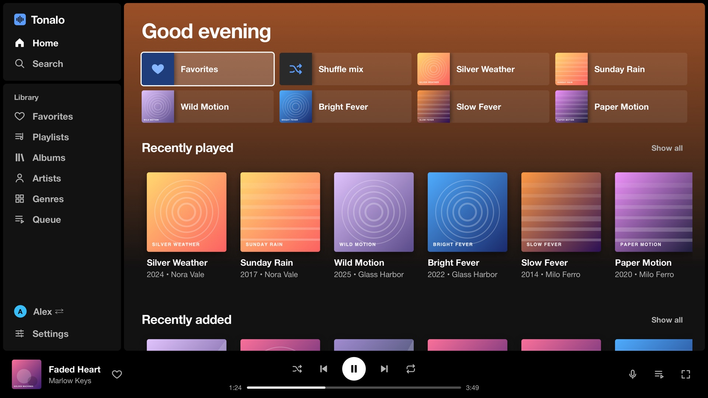
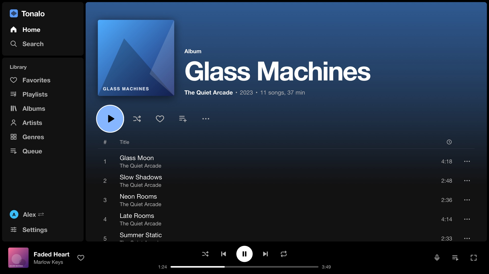
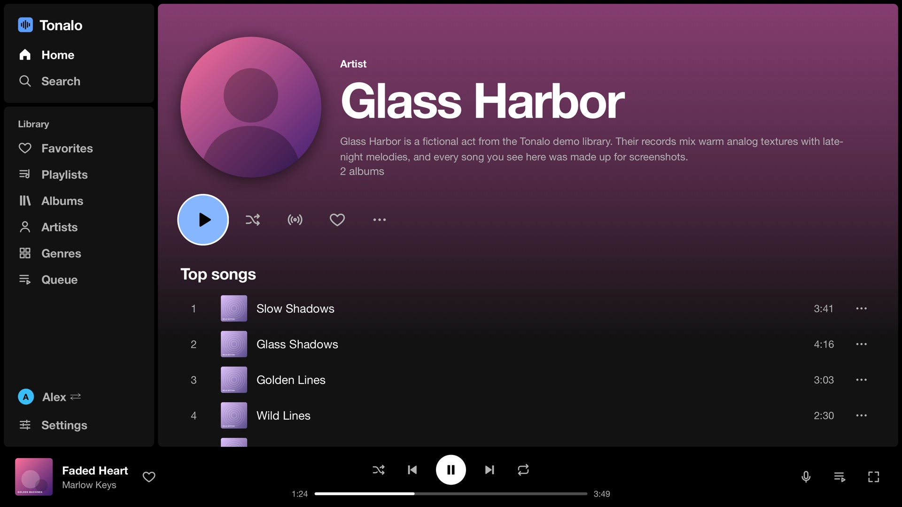
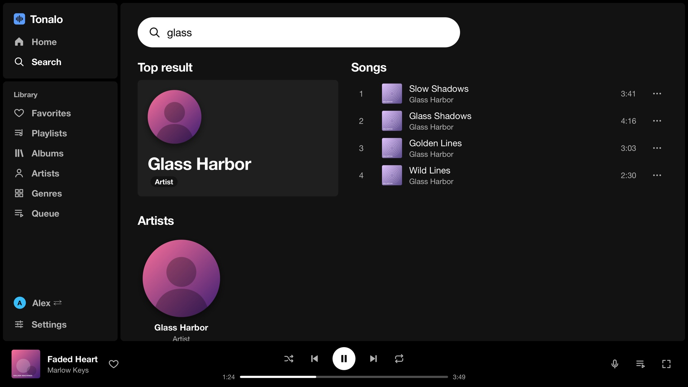

<p align="center"></p>

<h1 align="center">Tonalo</h1>

<p align="center">A Navidrome client for LG TVs. Play your own music library from the couch, with nothing but the remote.</p>



Navidrome's web UI technically works in the TV browser, but it's made for a mouse and gets fiddly fast. Tonalo is a native webOS app built around the remote: arrow keys and OK to get around, Back to go back, and the play/pause and skip buttons do what you'd expect.

It talks to any server that speaks the Subsonic API. It was built and tested against Navidrome; other Subsonic servers should work but haven't been tried.

## What it does

- Home screen with recently played, recently added, most played and a shuffle mix
- Albums, artists, playlists, genres, favorites and search
- Full-screen player with synced lyrics (if your server has them)
- Queue that survives restarts, plus "play next", artist/song radio and adding to playlists
- Several people on one TV: everyone signs in once, then picks their profile on start. Queues and settings stay separate.
- Transcoding options for weaker Wi-Fi, scrobbling, and a moving screensaver so the OLED doesn't burn in
- English, German, Spanish, French, Italian, Portuguese, Dutch, Polish and Turkish – it follows the TV's language

| | |
|---|---|
|  |  |
|  |  |

<p align="center"></p>

The screenshots use a made-up demo library (`tools/mock_server.js`), not real artists.

## Installing

Grab the `.ipk` from the [latest release](../../releases/latest).

**Rooted TV with the Homebrew Channel** – the easiest way is the deploy script, which uploads the package over the root telnet shell, installs it and starts the app:

```bash
python3 tools/deploy.py 192.168.x.x    # your TV's IP
```

With SSH enabled you can also do it by hand:

```bash
scp tonalo_*.ipk root@<tv-ip>:/tmp/tonalo.ipk
ssh root@<tv-ip> "luna-send-pub -i 'luna://com.webos.appInstallService/dev/install' '{\"id\":\"tonalo\",\"ipkUrl\":\"/tmp/tonalo.ipk\",\"subscribe\":true}'"
```

**TV in Developer Mode** – install the package with [webOS Dev Manager](https://github.com/webosbrew/dev-manager-desktop) or `ares-install`. Keep in mind that Developer Mode expires unless you extend the session, and the TV removes the app when it does.

On first start, enter your server address (for example `http://192.168.1.10:4533`), user name and password. The password itself isn't stored, only the salted token the Subsonic API uses.

Tested on an LG OLED65CX with webOS 5.6. Anything from webOS 5 up should be fine; older versions are untested.

## Remote

| Button | Action |
|---|---|
| Arrows / OK | Move around / select |
| Back | Go back; at the top level it takes you to the sidebar, then asks to quit |
| ▶ ❚❚ ■ | Play, pause, stop |
| ⏪ ⏩ | Skip 10 seconds, hold to change songs |
| CH + / – | Scroll a page at a time |
| Red / Green / Yellow / Blue | Now playing / Search / Options / Play-pause |

The Magic Remote pointer works too.

## Development

There's no framework and no build step – plain HTML, CSS and JavaScript in `app/`. The code sticks to what the Chromium 68 engine in webOS 5 understands, so no optional chaining, `??`, flexbox `gap` and so on.

```bash
node tools/mock_server.js            # demo server + app on http://localhost:4599
python3 tools/build_ipk.py           # builds dist/*.ipk and the Homebrew Channel manifest
node tools/i18n_check.js             # checks that every language has every string
swift tools/screenshots.swift http://localhost:4599 shots   # renders the README screenshots (macOS)
```

In a desktop browser the UI scales to the window, and arrow keys, Enter and Esc behave like the remote. Log in to the mock server with any user name and password.

**Translations:** German is the source language. The code uses `T('German text')` and each file in `app/js/lang/` maps those strings to another language. To add a language, copy `en.js`, translate it, and register it in `index.html` and `app/js/i18n.js`. Corrections from native speakers are very welcome.

**Releases:** bump the version in `app/appinfo.json` and `app/js/util.js`, commit, then push a tag (`git tag v1.5.1 && git push origin v1.5.1`). GitHub Actions builds the package and publishes the release.

## Notes

Tonalo isn't affiliated with Navidrome or LG. A good part of the code was written together with an AI coding assistant; everything was tested on a real TV.

## License

[MIT](LICENSE)
